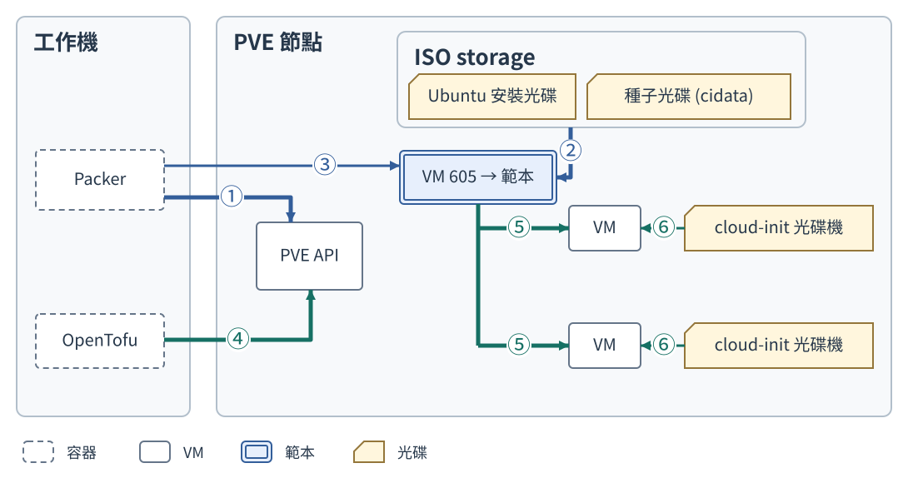

# pve-ubuntu-autoinstall

在 Proxmox VE（PVE）上，用設定檔全自動建立 Ubuntu Server 26.04 的 VM 範本，再從範本複製出 VM，並在複製時設定每台 VM 的網路、主機名稱與帳號。

範本是用官方安裝光碟裝出來的，不是 cloud image（雲端平台用的預製磁碟映像檔）。所以根目錄可以放在自訂的 LVM 配置上，登入畫面也和手動安裝一樣出現在 PVE 網頁的 Console。

## Key Features

- **Template as Code**：範本的硬體規格、磁碟配置、套件與清理步驟全部寫在設定檔裡並納入版本控制。同一份設定可以重複執行相同的建置流程，改動有紀錄可追。
- **Same as a Manual Install**：用官方安裝光碟與安裝程式建置，磁碟配置、核心套件、開機參數與 Console 行為都和手動安裝的系統相同。既有的維運方式與操作習慣都不用改。
- **Declarative VM Lifecycle**：所有 VM 列在一份清單裡，每台的 IP、帳號與規格各自定義。新增、調整、刪除 VM 都是修改清單後重新套用。
- **Nothing to Install**：Packer、OpenTofu 與它們的外掛都包在同一個容器映像檔裡，版本固定在 repo 裡。工作機只需要 podman 這類常見工具，PVE 節點不需要安裝任何套件。

## To start using

你需要一台運作中的 PVE，以及一台裝有 podman、能連到 PVE 的 Linux 工作機。每個環境的設定值放在自己的 overlay 目錄（`overlays/<名稱>`）裡，範本與 VM 的定義（`base/`）所有環境共用。填好名為 `lab` 的 overlay 之後，流程是三個指令：

```bash
scripts/build-template.sh lab   # 建立範本
scripts/tofu.sh lab init        # 初始化 OpenTofu，只有第一次需要
scripts/tofu.sh lab apply       # 從範本建立 VM
```

建立範本約 8 分鐘，建立一台 VM 約 1 分鐘，實際時間依磁碟與網路速度而定。

從零開始的完整步驟，包含事前檢查、依環境修改設定、建立 API 權杖與驗證結果，請看[建置手冊](docs/getting-started.md)。建好之後的新增、調整與刪除，請看[日常操作](docs/operations.md)。

## How It Works



流程分成兩個階段。階段一由 Packer 建立一台 VM 並掛上安裝光碟，讓 Ubuntu 安裝程式依設定檔自動完成安裝，清理後把這台 VM 轉成範本。階段二由 OpenTofu 從範本複製出 VM，把每台的設定寫進 PVE 的 cloud-init 欄位，VM 第一次開機時自行套用。

圖上每個編號的說明、兩個階段的詳細步驟，以及和手動安裝的差異，請看[運作原理](docs/how-it-works.md)。

## Known Limitations

- **適用環境有限**：支援的組合是 PVE 9.2 單一節點、SeaBIOS、lvmthin storage、Ubuntu Server 26.04。其他組合（叢集、UEFI、其他類型的 storage）可能需要調整設定。
- **建置時需要一個固定 IP 與套件來源**：建置期間 VM 會佔用一個固定 IP，工作機要能用 SSH 連到它，VM 也要能連到設定的 Ubuntu 套件來源。
- **開機指令依賴時間與光碟內容**：Packer 是模擬鍵盤輸入開機指令，等待秒數與核心路徑都對應這張 26.04 安裝光碟。
- **空閒的磁碟空間固定給根目錄**：磁碟配置可以在 YAML 裡調整，但開機時 VG 裡所有空閒的空間都會加給根目錄的 LV，無法分給其他 LV。
- **只能用 PVE 內建的 cloud-init 欄位**：複製時只能設定網路、主機名稱、一個帳號與它的密碼雜湊和 SSH 公鑰。
- **帳號的 sudo 不需要密碼**：帳號由 cloud-init 建立，預設可以免密碼使用 sudo，這點和手動安裝不同。
- **API 權杖的權限偏大**：權杖可以管理 PVE 上所有的 VM，也可以刪除 ISO storage 上的任何檔案。
- **狀態檔只存在本機**：OpenTofu 的狀態檔沒有遠端備份，也不能多人共用，裡面含有密碼雜湊。遺失後 OpenTofu 就不知道哪些 VM 歸它管理。
- **不會覆蓋現有範本**：範本的 VMID 已存在時建置會停止，要先手動刪除舊範本才能重建。

## License

本專案以 [MIT License](LICENSE) 授權。
