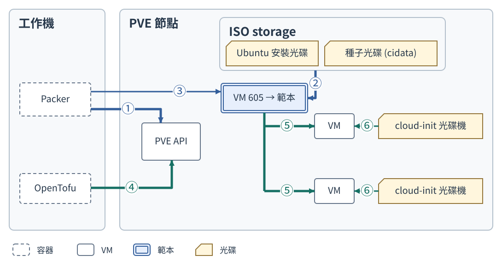
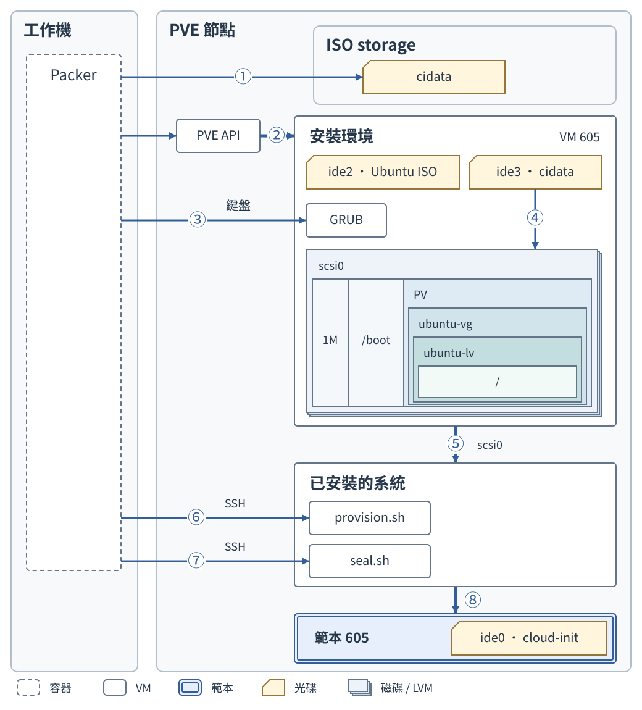
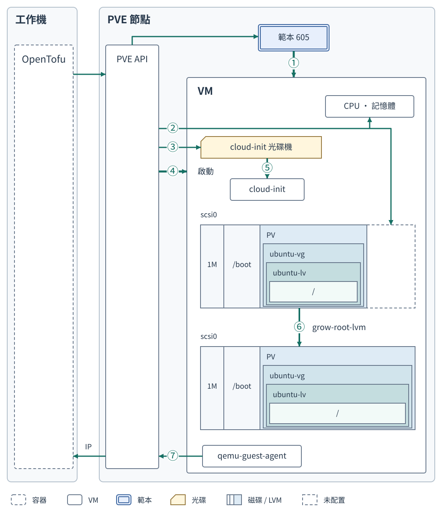

# 運作原理

這份文件說明兩個階段各自做了什麼、為什麼這樣做，以及做出來的系統和手動安裝有哪些差異。操作步驟請看[建置手冊](getting-started.md)。

## 總覽



| 編號 | 階段 | 發生的事 |
|---|---|---|
| ① | 一 | Packer 透過 PVE API 建立一台 VM，掛上 Ubuntu 安裝光碟與種子光碟 |
| ② | 一 | VM 605 從安裝光碟開機，安裝程式依種子光碟裡的設定把系統裝進磁碟 |
| ③ | 一 | 安裝完成後，Packer 用 SSH 連進 VM 605 檢查並清理，接著把它轉成範本 |
| ④ | 二 | OpenTofu 透過 PVE API 要求複製範本，並寫入每台 VM 的設定 |
| ⑤ | 二 | PVE 把範本 605 完整複製成新的 VM |
| ⑥ | 二 | VM 第一次開機時，從 cloud-init 光碟機讀取設定並套用 |

Packer 與 OpenTofu 都在工作機上以容器執行。兩者透過 PVE API 管理 VM；Packer 另外會用 SSH 直接連到建置中的 VM。

圖上的「種子光碟」是一張存放 autoinstall 設定的小光碟，磁碟標籤是 `cidata`，階段一的圖以這個標籤稱呼它。

**兩種設定機制的分工：**

| | autoinstall | cloud-init |
|---|---|---|
| 是什麼 | Ubuntu 安裝程式的自動安裝模式，依一份 YAML 回答所有安裝問題，過程不需要人操作 | 已安裝的系統在第一次開機時，讀取外部設定並套用的程式 |
| 在這個專案裡的用途 | 階段一，安裝當下 | 階段二，每台 VM 第一次開機時 |
| 決定什麼 | 磁碟分割與 LVM 配置、核心、套件、語系與時區 | IP、閘道、DNS、主機名稱、帳號、密碼雜湊、SSH 公鑰 |
| 設定寫在哪裡 | `base/packer/files/user-data.pkrtpl.yaml` | 每台各自的值在 overlay 的 `vms.tfvars` 與 `secrets.tfvars`；共用的閘道與 DNS 在 overlay 的 `site.hcl`；SSH 公鑰來自工作機 |

這個專案在安裝當下就用 autoinstall 建立指定的 LVM 配置，因為系統裝好之後根目錄已經在使用中，要改分割方式很麻煩。這也是不直接用 Ubuntu 的 cloud image（雲端平台用的預製磁碟映像檔）的原因：它的磁碟配置在映像檔製作時就定好了，cloud-init 只能設定系統，不能重新分割根目錄所在的磁碟。

## 階段一：建立範本



由 `scripts/build-template.sh <overlay>` 啟動。它每次執行都會產生一組隨機密碼給臨時帳號 `packer` 使用，再用容器執行 Packer。範本的 VMID 取自 overlay 的 `env` 裡的 `TEMPLATE_VMID`，以下以預設的 605 說明。

**① 上傳種子光碟**

Packer 把 autoinstall 設定做成一張小光碟，上傳到 PVE 的 ISO storage，在驗證用的環境裡大小約 370 KB。光碟的磁碟標籤是 `cidata`，裡面有 `user-data` 與 `meta-data` 兩個檔案。安裝程式開機時會尋找這個標籤的磁碟並讀取設定，這個機制稱為 NoCloud。

**② 建立 VM 605**

VM 的硬體規格定義在 `base/packer/ubuntu-2604.pkr.hcl`：SeaBIOS、`cpu: host`、`virtio-scsi-single` 控制器、virtio 網卡。沒有指定顯示卡，也沒有序列埠，所以使用 PVE 預設的 VGA。磁碟接在 `scsi0`，安裝光碟接在 `ide2`，種子光碟接在 `ide3`。

開機順序是磁碟優先。這時磁碟是空的，所以 BIOS 會改從安裝光碟開機。

**③ 輸入開機指令**

Packer 等待 8 秒讓開機選單出現，再模擬鍵盤輸入。它按 `c` 進入 GRUB（開機載入程式）的命令列，輸入三行指令手動載入安裝程式的核心：

```
linux /casper/vmlinuz autoinstall ---
initrd /casper/initrd
boot
```

需要這一步的原因：Ubuntu 安裝程式有一道安全機制，只有在核心開機參數裡看到 `autoinstall` 這個字，才會不經確認就開始安裝。光碟的開機選單沒有帶這個參數，直接開機的話，安裝程式會停在 `Continue with autoinstall? (yes|no)` 等人回答。

`autoinstall` 必須寫在 `---` 前面。安裝程式會把 `---` 後面的參數複製到裝好的系統，寫在前面的只影響這一次開機。

**④ 安裝系統**

安裝程式讀取種子光碟，依 `storage` 區塊分割磁碟。配置用到 LVM 的三層結構：PV（交給 LVM 管理的分割區）組成 VG（儲存空間集合），再從 VG 劃出 LV（邏輯磁碟區，上面建立檔案系統）。

| 分割區 | 大小 | 用途 |
|---|---|---|
| 1 | 1M | BIOS 開機分割區。GPT 磁碟在 SeaBIOS 上開機時，GRUB 需要它 |
| 2 | 2G | `/boot`（ext4） |
| 3 | 其餘空間 | PV，屬於 VG `ubuntu-vg`；LV `ubuntu-lv` 用滿整個 VG 並掛在 `/`（ext4） |

PV 放在最後一個分割區，之後加大磁碟時才能直接往後擴充。

同一份設定也指定了 `linux-generic` 核心、套件來源、要安裝 `openssh-server` 與 `qemu-guest-agent`，以及建置期間使用的固定 IP。

**⑤ 從磁碟重開機**

安裝完成後 VM 重開機。這次磁碟上有系統，所以從磁碟開機。autoinstall 設定裡指定的臨時帳號 `packer` 這時可以登入。

Packer 從步驟 ③ 之後就一直嘗試用 SSH 連線。安裝期間連到的是安裝環境，帳號不存在所以登入失敗；重開機後連到裝好的系統，登入成功，才進行下一步。

**⑥ 檢查並安裝磁碟擴充服務**

Packer 上傳並執行 `base/packer/scripts/provision.sh`。它先確認安裝結果符合預期，任何一項不符就讓建置失敗：

- 根目錄在 `ubuntu-vg/ubuntu-lv` 上，`/boot` 是獨立的檔案系統，VG 沒有剩餘空間。
- 已安裝 `linux-generic`。
- 核心開機參數裡沒有 `console=`，也沒有 `autoinstall`。
- `qemu-guest-agent` 已啟用或正在執行。
- 找得到擴充分割區用的 `growpart` 指令。

接著安裝 `grow-root-lvm` 服務，它的作用在階段二的步驟 ⑥ 說明。

**⑦ 清理**

Packer 執行 `base/packer/scripts/seal.sh`，移除不該被每台 VM 共用的東西：

- **重新啟用 cloud-init**：用安裝光碟裝出來的系統，cloud-init 在第一次開機後會被停用，資料來源（datasource）也被設成 `None`。腳本執行 `cloud-init clean --logs --machine-id --seed`，這個指令會連帶執行安裝程式留下的清理掛鉤 `/etc/cloud/clean.d/99-installer`，刪除造成停用的設定檔，以及安裝時寫入的網路設定 `/etc/netplan/00-installer-config.yaml`。
- **移除機器識別資料**：machine-id 與 SSH 主機金鑰。每台 VM 第一次開機時會各自重新產生。
- **刪除臨時帳號** `packer` 與它的家目錄。

**⑧ 轉成範本**

Packer 透過 PVE API 把 VM 關機、卸除兩張光碟並移除光碟機、轉成範本。完成的範本上有一台空的 cloud-init 光碟機（`ide0`）。上傳的種子光碟也會從 ISO storage 刪除。

## 階段二：建立 VM



由 `scripts/tofu.sh <overlay> apply` 啟動。OpenTofu 比對 overlay 的 `vms.tfvars` 裡的清單與狀態檔，找出需要建立、修改或刪除的 VM。以下是建立一台 VM 的過程。

**① 複製範本**

PVE 把範本 605 完整複製成一台新的 VM。新 VM 有自己的磁碟，不依賴範本。

**② 調整規格**

OpenTofu 依清單設定 CPU 與記憶體。`disk_gb` 大於範本的磁碟時，PVE 會把虛擬磁碟加大。這時只有磁碟本身變大，裡面的分割區與檔案系統還是原來的大小。

**③ 寫入 cloud-init 欄位**

OpenTofu 把這台 VM 的 IP、閘道、DNS、帳號名稱、密碼雜湊與 SSH 公鑰寫進 PVE 的 cloud-init 欄位，也就是 PVE 網頁上 VM 的 Cloud-Init 分頁。主機名稱取自 VM 名稱。PVE 依這些欄位產生 cloud-init 光碟機的內容。

密碼欄位填的是 SHA-512 雜湊，不是密碼本身。PVE 收到這種格式的雜湊時會原樣交給 cloud-init，所以明文密碼不會出現在設定檔、狀態檔或 PVE 的 VM 設定裡。

**④ 啟動 VM**

PVE 啟動這台已經設定好硬體與 cloud-init 光碟機的 VM。接下來的 ⑤ 到 ⑦ 分別說明 VM 裡三個服務做的事，它們各自啟動，編號不代表誰等誰。

**⑤ cloud-init 套用設定**

VM 第一次開機時，cloud-init 找到 cloud-init 光碟機並讀取內容，接著：

- 寫入網路設定並啟用。
- 設定主機名稱。
- 建立帳號，設定密碼雜湊與 SSH 公鑰。在驗證用的環境裡，這個帳號的 UID 是 1000，可以免密碼使用 `sudo`。
- 產生這台 VM 自己的 SSH 主機金鑰。

**⑥ 擴充根目錄**

`grow-root-lvm` 服務在每次開機時執行，依序處理四層：

1. 把 PV 所在的分割區擴大到磁碟結尾。
2. 用 `pvresize` 讓 PV 使用整個分割區。
3. 用 `lvextend` 把 VG 裡**所有**空閒的空間加給根目錄的 LV。
4. 同時擴大 LV 上的檔案系統。

分割區已經到磁碟結尾、VG 也沒有空閒空間時，它不會改動任何東西。腳本只處理預設的配置形式：根目錄在 LVM 上、VG 只有一個 PV、PV 是一個分割區；不符合時它會直接結束。之後再把磁碟加大時，重開機或執行 `sudo systemctl start grow-root-lvm` 就會生效。

需要這個服務的原因：cloud-init 內建的磁碟擴充功能只處理「根目錄直接放在分割區上」的情況，根目錄在 LVM 上時，它不會擴充 PV 與 LV。

**⑦ 回報 IP**

VM 裡的 `qemu-guest-agent` 把網路介面與 IP 回報給 PVE。在驗證用的環境裡，OpenTofu 會等到這份資訊才結束。`apply` 最後列出的 IP 是設定檔裡的值，不是 agent 回報的值，所以實際能不能連線要另外確認。

## 和手動安裝的差異

這個專案以同一個環境裡手動安裝的 VM 為對照，確認範本的磁碟配置、核心套件、開機參數與 Console 行為都和它相同。套件的實際版本會隨安裝當下的安全性更新而不同。刻意不同的地方有四項：

| 差異 | 原因 |
|---|---|
| 多安裝了 `qemu-guest-agent` | PVE 與 OpenTofu 靠它取得 VM 的 IP |
| 多了 `grow-root-lvm` 服務 | 加大磁碟後自動擴充根目錄 |
| cloud-init 保持啟用 | 範本要靠它接收每台 VM 的設定。手動安裝的系統在第一次開機後會停用它 |
| 帳號可以免密碼使用 `sudo` | 帳號由 cloud-init 建立時的預設行為。手動安裝建立的帳號需要輸入密碼 |

在 PVE 的硬體設定上，從範本複製出來的 VM 和對照用的手動 VM 相比，多出來的設定項只有 cloud-init 光碟機與 cloud-init 欄位。`scripts/verify.sh` 會比對設定項的種類，以及 CPU 類型、SCSI 控制器、開機順序等幾個關鍵值。

## API 權杖的權限

`scripts/pve-access.sh` 建立的使用者 `automation@pve` 有以下權限，權杖 `automation@pve!iac` 的權限和它相同：

| 範圍 | 角色 | 可以做什麼 |
|---|---|---|
| `/vms` | `PVEVMAdmin`（內建） | 建立、設定、複製、開關機、刪除 PVE 上的**所有** VM。在叢集裡，範圍是整個叢集 |
| `/storage/vmdata` | `PVEDatastoreUser`（內建） | 配置 VM 磁碟與 cloud-init 光碟機 |
| `/storage/local` | `AutomationIso`（自訂） | 讀取 ISO、上傳種子光碟、刪除檔案 |
| `/sdn/zones/localnetwork/vmbr1` | `PVESDNUser`（內建） | 把 VM 的網卡接到這個橋接器 |
| `/nodes/node5` | `PVEAuditor`（內建） | 讀取節點狀態 |

有兩點範圍偏大，請留意：

- VM 的權限涵蓋 PVE 上所有的 VM，不限於這個專案建立的，也不限於單一節點。
- PVE 的刪除權限（`Datastore.Allocate`）以整個 storage 為單位。Packer 需要它來刪除自己上傳的種子光碟，但權杖因此也能刪除 `local` 上的其他 ISO 與備份。

這組權杖不能修改節點設定、使用者與其他 storage。

## 尚未實作的設計

### 用設定檔定義磁碟擴充規則

以下內容**還沒有實作**，目前建立 `disk-growth.yaml` 不會有任何效果。這一節只是把已經討論過的設計記錄下來。

**現況**：磁碟與 LVM 的配置可以在 `user-data.pkrtpl.yaml` 裡調整，但 `grow-root-lvm` 的規則是寫死的，VG 裡空閒的空間固定全部加給根目錄的 LV。範本改成多個 LV 之後，其他 LV 不會跟著磁碟變大。

**已定案的設定格式**：新增 `base/packer/files/disk-growth.yaml`，列出新空間依什麼比例分給哪些 LV。

```yaml
# share 是百分比，總和不可超過 100；不足 100 的部分留在 VG 裡不配置。
volume_group: ubuntu-vg
grow:
  - lv: ubuntu-lv   # /
    share: 30
  - lv: var-lv      # /var
    share: 50
```

**已定案的行為規則**：

- 每次開機時先擴充分割區與 PV，再依 `share` 把新增的空間分給各 LV，並同步擴大檔案系統。
- 沒列到的 LV 不會變動。
- `grow` 是空清單時，只擴充分割區與 PV，新空間全部留在 VG 裡。
- 設定有錯時不動磁碟，例如 `share` 總和超過 100，或列了不存在的 LV。腳本記錄錯誤後結束，不影響開機。

**實作時要注意**：

- 規則是「分配新增的空間」，不是「分配當下的空閒空間」。否則刻意保留不配置的部分，下次開機時又會被分掉。腳本需要在 VM 內用一個狀態檔記住上次處理到的磁碟大小。
- 選用比例而不是固定大小，是因為固定大小無法回答「磁碟再次加大時怎麼分」。
- 在驗證用的環境裡，手動安裝的 Ubuntu Server 26.04 已經有 Python 與 YAML 模組（cloud-init 與 netplan 依賴它們），所以 VM 內的腳本應該可以直接讀 YAML，不必加裝套件。實作時要再確認。

**尚未決定**：規則在哪一層生效。

| 選項 | 做法 | 代價 |
|---|---|---|
| 綁在範本上 | 建置範本時把 `disk-growth.yaml` 複製到 VM 的 `/etc/disk-growth.yaml`，同一個範本複製出來的 VM 共用一份規則。個別 VM 要不同規則時，登入後修改這個檔案再重開機 | 無法在 OpenTofu 的 VM 清單裡為個別 VM 指定規則 |
| 每台 VM 在清單裡指定 | 在 overlay 的 `vms.tfvars` 為每台 VM 寫規則，複製時傳進 VM | PVE 內建的 cloud-init 欄位傳不了這種設定，要改用自訂的 cloud-init 設定檔：ISO storage 要啟用 snippets、OpenTofu 要能 SSH 到 PVE 節點，而且 PVE 網頁上的 cloud-init 欄位會失效 |

規則必須和 LV 的配置對得上，而 LV 的配置是在建置範本時決定的，所以目前傾向第一個選項。
